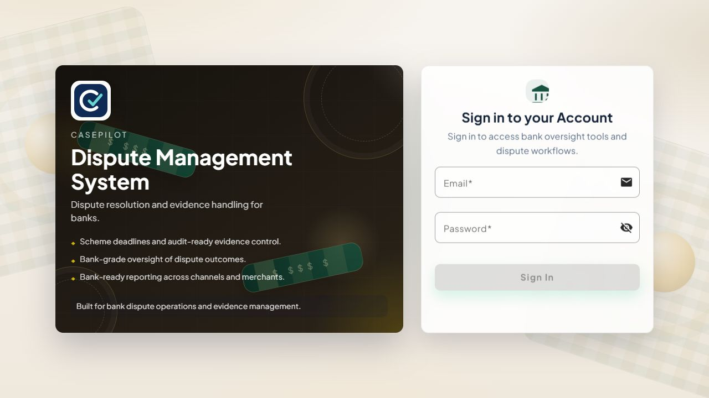
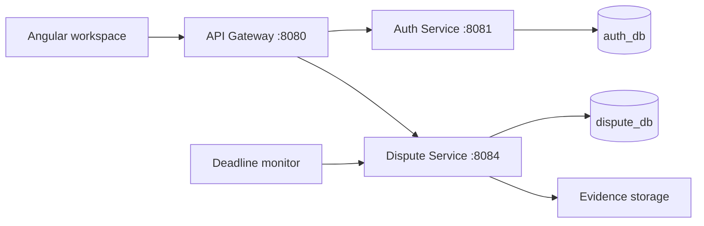

<p align="center"></p>

# CasePilot

### Bank dispute operations, from intake to resolution

CasePilot is a full-stack application for managing payment disputes inside a bank. It brings case intake, evidence, staff handoffs, deadlines, resolution records, and operational reporting into one workspace.

A dispute rarely belongs to one person from start to finish. Intake officers capture the transaction, reviewers assess the case, evidence officers collect supporting documents, and resolution staff record the outcome. CasePilot models those responsibilities explicitly, with role-based queues and controlled status transitions.



## What it does

| Capability | How it works |
| --- | --- |
| Dispute intake | Captures transaction, merchant, network, channel, type, and reason; evaluates eligibility before opening a case. |
| Case workflow | Enforces allowed status transitions and routes work to the staff role responsible for the next stage. |
| Evidence management | Stores files with uploader, timestamp, and content-type metadata; requires evidence before submission. |
| Deadline monitoring | Tracks internal and network due dates, flags breaches, and creates approaching-deadline notifications. |
| Operational reporting | Summarizes case volume, resolution times, outcomes, overdue cases, and fraud flags; exports CSV reports. |
| Administration | Manages staff accounts, roles, account status, SLA rules, policies, and training quizzes. |
| Staff awareness | Links assessments to policies and records scores, attempt history, and awareness metrics. |

The case list supports search, status filtering, and CSV export over the records loaded into the view. Dashboard and bank-report endpoints provide reporting-period summaries.

## Objectives

- Give operations teams a consistent record of each dispute and its supporting evidence.
- Make ownership and handoffs visible throughout the investigation.
- Surface approaching deadlines before cases become overdue.
- Enforce access, workflow, assignment, and evidence requirements in the backend.
- Give supervisors a practical view of volume, resolution performance, and exceptions.
- Connect policy administration and staff training to daily operations.

## Architecture



The gateway is the browser's API entry point. Auth Service owns identity and credentials. Dispute Service owns cases, evidence metadata, deadlines, reporting, policies, quizzes, and notifications. The services use separate MySQL databases; evidence files are stored on disk.

## Technology stack

| Layer | Technologies |
| --- | --- |
| Web application | Angular 17.3, TypeScript 5.4, Angular Material, RxJS 7.8, SCSS |
| Backend | Java 17, Spring Boot 3.2.5, Spring MVC, Spring Data JPA, Hibernate |
| Gateway | Spring Cloud Gateway, WebFlux, Spring Cloud 2023.0.1 |
| Identity | Spring Security, BCrypt password hashing, JJWT 0.12.5 |
| Persistence | MySQL 8; H2 for isolated integration tests |
| Tooling | Maven, npm, Docker Compose, GitHub Actions |
| Tests | JUnit 5, Spring Boot Test, MockMvc |

## Run locally

**Prerequisites:** JDK 17, Maven 3.9+, Node.js 20, npm, and MySQL 8. Docker Compose is optional if MySQL is already installed.

```powershell
git clone https://github.com/tondebonasy/CasePilot.git
cd CasePilot
Copy-Item .env.example .env
```

Edit `.env` with a shared random JWT secret, database credentials, and a local administrator password. Import it into your current PowerShell session:

```powershell
. .\scripts\Import-LocalEnvironment.ps1
```

For a new Docker-based database:

```powershell
docker compose --env-file .env -f backend/docker-compose.yml up -d mysql
```

Install the frontend dependencies:

```powershell
npm --prefix frontend/casepilot ci
```

Start each component in a separate terminal. In each backend terminal, import the same `.env` from the repository root before running Maven:

| Component | Command from repository root | Address |
| --- | --- | --- |
| Auth Service | `mvn -f backend/auth-service/pom.xml spring-boot:run` | `http://localhost:8081` |
| Dispute Service | `mvn -f backend/dispute-service/pom.xml spring-boot:run` | `http://localhost:8084` |
| API Gateway | `mvn -f backend/api-gateway/pom.xml spring-boot:run` | `http://localhost:8080` |
| Frontend | `npm --prefix frontend/casepilot start` | `http://localhost:4200` |

To create the first administrator, set `SEED_ADMIN_ENABLED=true` and `SEED_ADMIN_PASSWORD` locally before starting Auth Service. Sign in as **`admin@casepilot.local`** using your configured password, then disable seeding. The seeder never overwrites existing accounts.

See the [setup guide](docs/SETUP.md) for secret generation, existing MySQL installations, IntelliJ configuration, the Windows launcher, and troubleshooting.

## Explore the application

1. Sign in and review the dashboard and role queues.
2. Create staff accounts from **Admin Panel → Users**.
3. Configure an SLA rule for a network and dispute type.
4. Create a dispute using a recent, synthetic transaction.
5. Review eligibility, claim the case, and move through the permitted stages.
6. Upload evidence before submission; record an outcome and close the case.
7. Inspect activity, posting records, notifications, and reports.
8. Create a policy and quiz, then complete the assessment from **Bank Training**.

Fresh installations start with empty case, policy, and quiz lists. They do not include customer data or a published default password.

## Build and test

```powershell
npm --prefix frontend/casepilot run build -- --configuration production
mvn -f backend/api-gateway/pom.xml test
mvn -f backend/auth-service/pom.xml test
mvn -f backend/dispute-service/pom.xml test
```

The dispute-service suite covers deadline calculation, workflow rules, evidence requirements, training scores, authenticated API access, policy and quiz creation, reporting endpoints, and rejection of non-admin access. Tests use H2 and a test-only signing key, separate from local MySQL. The frontend production build checks TypeScript and Angular templates. GitHub Actions runs these checks for pushes and pull requests.

## Engineering decisions

- **Workflow rules belong in the backend.** The service validates transitions, assignment, and evidence requirements regardless of the calling client.
- **Identity and case data have separate ownership.** Credentials are managed independently of the dispute domain.
- **Files and metadata have different storage needs.** File bytes live on disk; searchable case metadata remains relational.
- **Background monitoring records events.** Deadline alerts do not depend on an open browser.
- **Tests exercise HTTP behavior as well as services.** MockMvc checks authentication, mappings, response formats, and role restrictions.

## Documentation

- [Architecture and data model](docs/ARCHITECTURE.md)
- [Setup and troubleshooting](docs/SETUP.md)
- [Workflows and roles](docs/WORKFLOWS.md)
- [API reference](docs/API.md)
- [Security and deployment](docs/SECURITY.md)
- [Frontend styling guide](frontend/casepilot/UI_README.md)

## Integration boundaries

CasePilot records dispute operations; it does not connect to a live card-network submission API or a bank's core ledger. Submission references, financial postings, and notifications are application records. Fraud flags use deterministic rules. Scheme deadlines and reason mappings require validation against the rules adopted by a deploying bank.

The implemented client is a web application. This repository does not contain a native mobile application or a blockchain integration.
