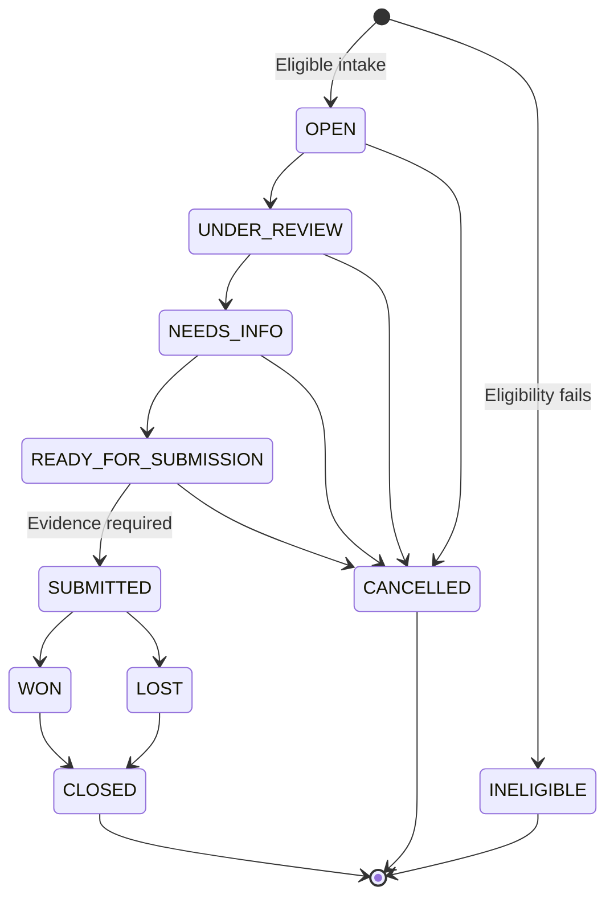

# Workflows and roles

## Intake and eligibility

A new dispute captures transaction details, merchant, amount, currency, network, channel, dispute type, and narrative. The service resolves the transaction, assigns reason mappings, calculates deadlines, and evaluates eligibility.

Eligible cases enter `OPEN`. Ineligible cases are retained as `INELIGIBLE` with an explanation and do not proceed. Intake also creates activity and notification records and evaluates deterministic fraud signals.

## Lifecycle

Transitions follow the implemented service rules. Cases move through the configured stages in order; jumping directly from intake to submission is rejected.

## Roles

| Role | Responsibility |
| --- | --- |
| Customer | Accesses cases they opened |
| Intake officer | Handles open cases and intake handoff |
| Reviewer | Handles cases under review |
| Evidence officer | Handles the information and evidence stage |
| Network liaison | Handles cases ready for submission |
| Resolution officer | Handles submitted cases, outcomes, and closure |
| Agent | Compatibility staff role; actions remain subject to service checks |
| Compliance | Reviews the broader portfolio, subject to operation-specific rules |
| Admin | Manages users and configuration and has administrative workflow access |

Queues distinguish assigned work from unassigned cases available to the current role. A transition into a different role's stage releases the assignment for the next team. Services enforce role, assignment, and transition checks.

## Evidence, submission, and resolution

Uploaded evidence produces file metadata and an activity record. Submission requires at least one evidence record. Moving to `SUBMITTED` creates an application submission reference and a temporary-credit posting record. A win creates a final-credit record; a loss creates a reversal record.

These records model operational events. They do not execute a bank transfer or transmit a submission to a payment network.

## Deadline monitoring

Administrators configure windows by network and dispute type. The monitor alerts within 72 hours of a deadline and records breaches once it passes. Recipients include the assignee and the person who opened the case, where applicable.

## Policies and training

1. Create a policy with a reference, summary, effective date, key requirements, and active status.
2. Create a linked quiz containing questions, answer options, and explanations.
3. Staff open **Bank Training** and submit answers.
4. The service scores and stores the attempt.
5. History and awareness reports summarize completion and performance by policy and role.

An empty policy or quiz list is expected on a fresh installation. Create an active policy before building a linked quiz.

## Demonstration sequence

Use synthetic transactions and sample evidence. Configure an SLA rule, create staff accounts for the workflow stages, open an eligible dispute with a recent transaction date, inspect the deadlines, move through review and evidence collection, record an outcome, and inspect activity and reports.
